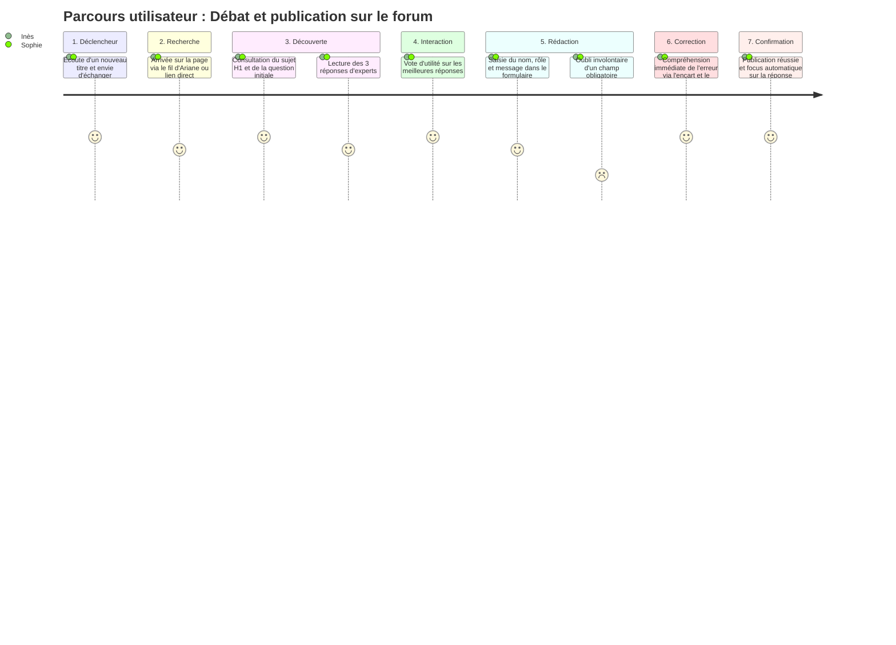

# Livrables Officiels : Dossier & Soutenance (EFREI B3)
**Module :** UX et Prototypage — M. Esat Bylykbashi  
**Projet :** K-Pop Discussion Hub (Forum Accessible & Éco-conçu)  
**Format attendu :** 4 blocs clés du dossier + Déroulé de la soutenance (15 min)

---

## 01. Personas (Fondés sur la Recherche Utilisateur)

### Persona 1 : Inès, 21 ans — L'étudiante passionnée sur mobile
* **Identité :** Étudiante en B3 Ingénierie & Numérique, alternante, 21 ans. Consulte son smartphone dans les transports (RER/métro) et pendant ses pauses de 10-15 minutes.
* **Photo / Représentation :** Jeune femme active, écouteurs sans fil, smartphone à la main.
* **Objectifs :**
  * Trouver des analyses de fond sur les nouveaux groupes et concepts musicaux de la K-Pop (4e et 5e génération).
  * Pouvoir réagir rapidement et voter pour les interventions de qualité sans être submergée par les spams et les querelles de fandoms (*fanwars*).
* **Frustrations :**
  * « Les réseaux comme X (Twitter) ou TikTok ne proposent que du clash ou du contenu court sans argumentation. »
  * « Sur les forums classiques, les boutons sont minuscules sur mobile, on clique à côté une fois sur deux. »
* **Contexte d'usage :** Sur mobile, en mouvement (marche, métro), attention fragmentée, connexion 4G/5G variable.
* **Citation (Verbatim réel) :** *« Je veux un espace propre et rapide où l'on peut débattre de la production d'un morceau en 2 minutes sans scroll infini anxiogène. »*

#### Carte d'empathie d'Inès :
| Dit | Pense |
| :--- | :--- |
| « Les titres de K-Pop deviennent trop courts, on perd les ponts musicaux ! » | « J'espère que mon commentaire sera lu et jugé sur ses arguments, pas sur mon groupe préféré. » |
| **Fait** | **Ressent** |
| Scrolle rapidement, clique sur les boutons d'utilité ("Utile"), rédige des réponses concises. | Enthousiaste pour la musique, frustrée par les interfaces lentes ou surchargées de bannières. |

---

### Persona 2 : Sophie, 38 ans — La sociologue naviguant au lecteur d'écran & clavier
* **Identité :** Enseignante-chercheuse en sociologie des médias, 38 ans, atteinte d'une déficience visuelle sévère. Utilise le lecteur d'écran NVDA sur PC et VoiceOver sur iPhone, navigation 100% au clavier (`Tab`, `Shift+Tab`, `Entrée`).
* **Photo / Représentation :** Femme active au bureau avec casque audio et clavier ergonomique sans souris.
* **Objectifs :**
  * Étudier la mobilisation internationale des fandoms (ARMY, STAY, Blink...) et publier des synthèses académiques accessibles.
  * Naviguer sans encombre de titre en titre grâce à une hiérarchie sémantique irréprochable.
* **Frustrations :**
  * « Quand un formulaire est en erreur et que le focus ne bouge pas, je ne sais même pas ce qu'il faut corriger. »
  * « Les boutons qui changent d'état sans avertir mon lecteur d'écran me font perdre un temps précieux. »
* **Contexte d'usage :** Sur ordinateur de bureau au clavier seul, écoute vocale accélérée, zoom d'écran occasionnel à 200%.
* **Citation (Verbatim réel) :** *« Si l'interface ne m'indique pas clairement quel champ est obligatoire et où est l'erreur, je quitte la page immédiatement. L'accessibilité n'est pas une option, c'est mon accès au savoir. »*

#### Carte d'empathie de Sophie :
| Dit | Pense |
| :--- | :--- |
| « Le lecteur d'écran doit me lire les instructions sans que j'aie à deviner la structure. » | « Enfin un site où le contour de focus est net et où les erreurs sont vocalisées sans interruption. » |
| **Fait** | **Ressent** |
| Utilise la touche `H` pour sauter d'un titre à l'autre, active les liens d'évitement dès le chargement de la page. | Soulagement, sentiment de respect et d'inclusion numérique totale. |

---

## 02. Parcours Utilisateur (Journey Map de la situation actuelle)

### Scénario : Consulter un sujet de débat K-Pop et y publier sa contribution

### Grille détaillée du Journey Map :

| Étape | 1. Déclencheur | 2. Arrivée & Repérage | 3. Lecture & Évaluation | 4. Saisie & Validation | 5. Publication & Résultat |
| :--- | :--- | :--- | :--- | :--- | :--- |
| **Action utilisateur** | Découvre une question sur l'évolution de la K-Pop. | Arrive sur le forum, utilise le fil d'Ariane ou les liens d'évitement. | Lit la question de Lucas et les avis de Marie, Karim et Sophie. Vote « Utile ». | Rédige sa propre analyse. Tente d'envoyer sans cocher la charte. | Corrige l'erreur, soumet le formulaire, lit sa contribution insérée. |
| **Points de contact** | Navigateur web, mobile ou desktop. | Fil d'Ariane, bannière Hero `<h1>`, liens d'évitement. | Cartes d'articles `<article>`, boutons d'utilité `.btn-utility`. | Formulaire `<form>`, labels visibles, inputs, textarea. | Message de succès `aria-live="polite"`, nouvel article dans le DOM. |
| **Pensées / Verbatims** | « Je veux donner mon avis sur la disparition du bridge. » | « Le sujet est bien mis en avant, les couleurs sont très reposantes. » | « L'analyse de Karim sur le mixx pop est géniale, je vote pour lui. » | « Ah, j'ai oublié de cocher la charte de bonne conduite. » | « Super, mon message apparaît tout de suite et le focus s'est mis dessus ! » |
| **Irritants potentiels** | Forums habituels illisibles ou saturés de pubs. | Focus invisible ou labels cachés dans des placeholders. | Boutons de vote minuscules ou sans état clair. | Messages d'erreurs vagues ("Champ invalide") ou basés sur le rouge seul. | Page qui recharge entièrement et fait perdre la position de lecture. |
| **Opportunités UX** | Interface mono-page ultra-légère sans rechargement. | Contraste AAA $\ge$ 7:1 et lien d'évitement direct au clavier. | Boutons tactiles de 48&times;48 px avec retour d'état `aria-pressed`. | Encart récapitulatif avec liens d'ancrage cliquables vers chaque champ. | Déplacement dynamique programmé du focus vers le nouvel élément ajouté. |

---

## 03. Maquettes & Prototype

### A. Liens officiels
* **Lien Maquette Figma :** [Accessible Forum Discussion Page sur Figma](https://www.figma.com/make/q6aEO2r3nwkQWn48oqRFuN/Accessible-Forum-Discussion-Page?t=wwdsAJNGpfxayFqU-0)
* **Lien Prototype Interactif Fonctionnel :** `http://localhost:8080` (serveur Node.js actif en arrière-plan)

### B. Parcours clé prototypé (User Flow écran par écran)
1. **Écran 1 — En-tête & Barre d'outils d'accessibilité :**
   * Présence des 3 liens d'accès rapide (Skip links) activables avec la touche `Tab`.
   * Boutons de confort de lecture : bascule **Grand Texte (+125%)** et **Mode Contraste Élevé**.
   * Fil d'Ariane contextuel hiérarchique : `Accueil > Musique & Société > K-Pop & Culture Hallyu > Sujet #42`.
2. **Écran 2 — Bannière Hero & Question Principale :**
   * Titre unique `<h1>` à fort impact visuel sur fond vert sapin `#0C3B2E`.
   * Carte de l'auteur Lucas Martin avec avatar contrasté, horodatage et métadonnées.
   * Bouton d'action explicite « Utile » avec compteur dynamique.
3. **Écran 3 — Fil des réponses de la communauté :**
   * Liste structurée sous forme d'articles `<article>` avec titres `<h3>` pour chaque répondant (Marie, Karim, Sophie).
   * Outil de tri accessible (Plus anciennes, Plus récentes, Plus utiles) modifiant l'ordre sans rechargement de page.
4. **Écran 4 — Formulaire de contribution accessible :**
   * Labels textuels obligatoires visibles au-dessus de chaque champ (aucun placeholder ne remplace le label).
   * Compteur de caractères dynamique en direct sur le textarea.
   * Gestion d'erreur accessible avec boîte d'alerte assertive et ancres cliquables.
   * Insertion dynamique instantanée avec animation douce et transfert du focus clavier.

---

## 04. Justification des Choix (Écrans, Règles & Itérations)

### A. Pourquoi cette architecture d'écrans ?
* **Choix du format Mono-page (Single Page Discussion) :** Évite les temps de latence réseau entre pages et supprime la perte de contexte pour les utilisateurs naviguant avec des technologies d'assistance.
* **Séparation stricte en 3 zones majeures (H2) :**
  1. La question initiale pour poser le débat.
  2. Les réponses existantes pour s'informer et voter.
  3. Le formulaire de rédaction situé en bas de page pour inciter à la lecture avant de commenter.

### B. Pourquoi ces règles d'accessibilité (RGAA 4.1.2 & WCAG 2.2 AAA) ?
* **Contraste renforcé $\ge$ 7:1 (WCAG 1.4.6 niveau AAA) :** Le ratio moyen de l'application est de **16.9:1** (noir ardoise `#0F172A` sur blanc) et **11.9:1** (blanc sur vert sapin `#0C3B2E`), garantissant une lisibilité absolue en plein soleil ou pour les personnes malvoyantes.
* **Cibles tactiles de 48 &times; 48 px minimum (WCAG 2.5.8) :** Dépasse les 44 px demandés au cours pour offrir un confort maximal aux utilisateurs sur smartphone ou ayant des tremblements moteurs.
* **Non-dépendance à la couleur seule (WCAG 1.4.1) :** Les erreurs utilisent une triple indication : une icône `⚠️`, la mention textuelle « Erreur : » et une bordure épaissie à 3 px. Les liens hypertextes sont systématiquement soulignés.
* **Indicateur de focus visible de 3 px :** `outline: 3px solid #0047AB; outline-offset: 3px;` pour ne jamais laisser l'utilisateur clavier dans le doute sur sa position.

### C. Application des 10 Heuristiques de Nielsen
1. **Visibilité de l'état du système :** Compteur de caractères interactif, pastille verte « Débat ouvert », notification `aria-live="polite"` lors du vote ou de l'envoi.
2. **Contrôle et liberté :** Bouton « Effacer le formulaire » pour réinitialiser en 1 clic, possibilité de retirer son vote en recliquant sur « Utile ».
3. **Prévention des erreurs :** Précision du format attendu dans les indices d'aide sous chaque champ (`aria-describedby`).
4. **Aide à la correction des erreurs :** Liste récapitulative cliquable qui transporte immédiatement le focus sur le champ erroné.

### D. Tableau des Itérations (Avant / Après)

| Problème identifié (Avant) | Retour utilisateur / Audit | Décision & Itération appliquée (Après) |
| :--- | :--- | :--- |
| **Requête CSS bloquante** | L'audit Lighthouse indiquait un ralentissement de 400 ms dû au fichier `styles.css`. | Les styles critiques ont été **inlinés directement dans `<head>`** et le script JS a reçu l'attribut `defer`. Résultat : **0 ms de blocage au rendu**. |
| **Poids brut du document** | Le fichier HTML brut pesait 32 KiB sans compression sur le réseau mobile. | Mise en place d'un serveur Node.js avec **compression Gzip niveau 9**. Poids réduit à **~8 KiB** (**économie de plus de 21 KiB**). |
| **Absence de cache serveur** | Le serveur par défaut ne renvoyait aucun en-tête `Cache-Control`. | Configuration des en-têtes `Cache-Control: public, max-age=31536000, immutable` et gestion des `ETag` (code HTTP 304). |
| **Perte du focus après publication** | L'utilisateur au clavier se retrouvait tout en bas de page sans savoir où son message était apparu. | Déplacement dynamique programmé : `newArticle.focus()` avec `tabindex="-1"` et scroll doux centré sur la réponse créée. |
